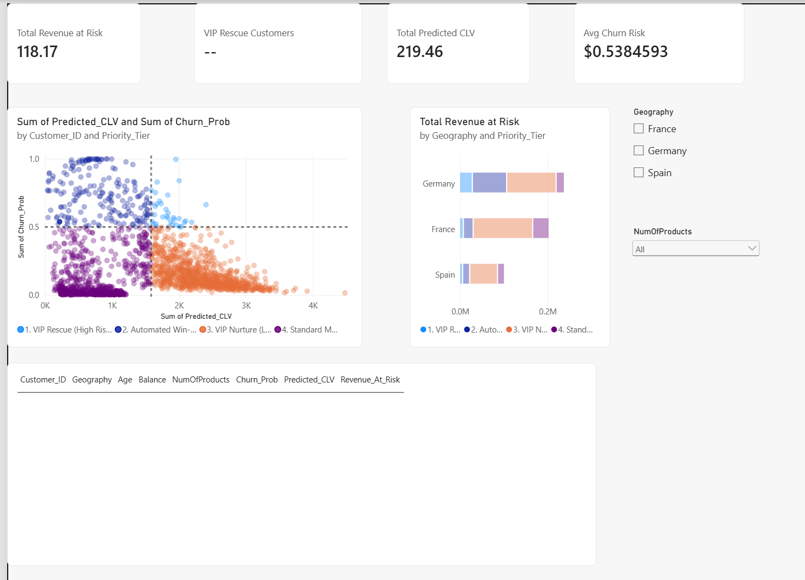

# Multi-Task Banking Customer Churn & Lifetime Value (CLV) Prediction Engine

An end-to-end machine learning engineering and business intelligence pipeline built with **TensorFlow**, **Scikit-Learn**, **FastAPI**, and **Power BI**. This system simultaneously predicts customer churn probability and 12-month Customer Lifetime Value (CLV), translating raw neural network outputs into an actionable **Retention Risk-Matrix** served via a low-latency REST API and visualized for executive decision-making.


---

## 1. Business Problem & Objective

Retail banks face a dual challenge in customer retention:
1. **Limited Retention Budgets:** Offering fee waivers, preferential interest rates, or relationship manager outreach to every customer erodes profit margins.
2. **Asymmetric Customer Value:** Losing a high-balance, multi-product client costs significantly more than losing an inactive, low-balance account.

**Solution:** Rather than treating churn classification and value estimation as disconnected workflows, this project uses a **Multi-Task Deep Learning Architecture** to learn shared customer behavioral representations and output both metrics simultaneously. The system calculates **Expected Revenue at Risk** (`Churn Probability × Predicted CLV`) and segments customers into four operational retention tiers.

---

## 2. End-to-End System Architecture

```text
+-----------------------------------------------------------------------------------+

|                             1. DATA INGESTION & PREP                              |
|  Raw Banking Records (10,000 rows) ---> Proxy 12-Mo CLV Target Engineering        |
|  Train/Test Stratified Split (80/20) ---> ColumnTransformer (Scaler + OneHot)     |
+-----------------------------------------+-----------------------------------------+
                                          |
                    +---------------------+---------------------+
                    v                                           v
+---------------------------------------+   +---------------------------------------+

|   2. MULTI-TASK TENSORFLOW MODEL      |   |   3. SERIALIZED ARTIFACTS             |
|   Input Layer (11 features)           |   |   - churn_clv_model.keras             |
|         |                             |   |   - bank_preprocessor.joblib          |
|   Shared Trunk (Dense 128 -> BN ->    |   +-------------------+-------------------+
|   Dropout 0.3 -> Dense 64)            |                       |
|      /                  \             |                       |
|     v                    v            |                       |
| [Churn Head]        [CLV Head]        |                       |
| Dense(32, ReLU)     Dense(32, ReLU)   |                       |
| Dense(1, Sigmoid)   Dense(1, Linear)  |                       |
+-------------------+-------------------+                       |

                    |                                           |
                    +---------------------+---------------------+
                                          |
                    +---------------------+---------------------+
                    v                                           v
+---------------------------------------+   +---------------------------------------+

|   4A. REAL-TIME REST API (FastAPI)    |   |   4B. BATCH SCORING & BI REPORTING    |
|   - Uvicorn ASGI Server               |   |   - Risk-Matrix Quadrant Assignment   |
|   - Pydantic Schema Validation        |   |   - Matplotlib Model Diagnostics      |
|   - POST /predict (<30ms latency)     |   |   - Power BI Executive Dashboard      |
+---------------------------------------+   +---------------------------------------+
```

---

## 3. Repository Structure

```text
├── notebooks/
│   └── churn_clv_pipeline.ipynb       # Model training, evaluation, and Matplotlib visuals
├── src/
│   └── api.py                         # FastAPI production inference server
├── artifacts/
│   ├── churn_clv_model.keras          # Saved TensorFlow Functional API model
│   └── bank_preprocessor.joblib       # Fitted Scikit-Learn ColumnTransformer
├── data/
│   └── bank_churn_clv_predictions.csv # Scored test dataset for Power BI ingestion
├── assets/
│   ├── model_diagnostics_dashboard.png # 4-panel Matplotlib validation summary
│   └── powerbi_dashboard_preview.png   # Executive Power BI report screenshot
├── requirements.txt                   # Python dependencies
└── README.md                          # System documentation
```

---

## 4. Pipeline & Technical Design Decisions

### A. Feature Engineering & Leakage Prevention
* **Dataset:** 10,000 retail banking records containing credit score, geography, gender, age, tenure, account balance, product count, credit card status, active membership status, and estimated salary.
* **Proxy CLV Formulation:** Combines net interest margin on account balances (`1.5%`), annual product cross-sell fees (`$120/product`), and wealth-management fee potential (`0.5% of salary`), discounted by retention status.
* **Strict Fit/Transform Separation:** The `ColumnTransformer` (`StandardScaler` for numerical columns, `OneHotEncoder` with `drop="first"` for categorical columns) is fitted **exclusively** on the 80% stratified training split and serialized via `joblib` to guarantee identical transformations during live inference.

### B. Multi-Task Neural Network (Keras Functional API)
* **Shared Trunk:** Captures cross-feature interactions (e.g., high balance + inactive membership in specific regions) using `Dense(128)` -> `BatchNormalization` -> `Dropout(0.3)` -> `Dense(64)`.
* **Loss Balancing (`loss_weights`):** Because Mean Squared Error (MSE) on dollar CLV values operates on a scale of $10^4$–$10^5$ while Binary Crossentropy stays between $0.0$ and $1.0$, the CLV loss is weighted by `0.00005`. This prevents regression gradients from dominating shared layer updates.
* **Regularization:** Uses `EarlyStopping` monitoring validation loss (`patience=8`, `restore_best_weights=True`) to halt training at peak generalization.

### C. Decision Logic: The Retention Risk-Matrix
Model outputs are converted into business rules using a **50% Churn Probability** cutoff and the **Median Predicted CLV** threshold:

| Priority Tier | Churn Probability | Predicted CLV | Operational Action |
| :--- | :--- | :--- | :--- |
| **1. VIP Rescue (Critical)** | $\ge 50\%$ | $\ge \text{Median}$ | Immediate relationship manager outreach, fee waivers, or custom rate offers. |
| **2. Automated Win-Back** | $\ge 50\%$ | $< \text{Median}$ | Low-cost automated push notifications, email sequences, or small cashback offers. |
| **3. VIP Nurture** | $< 50\%$ | $\ge \text{Median}$ | No retention discounts needed; prioritize wealth/credit product cross-selling. |
| **4. Standard Monitor** | $< 50\%$ | $< \text{Median}$ | Maintain standard digital banking experience. |

---

## 5. Model Diagnostics & Visual Validation

Before deploying to Power BI, the pipeline generates a 300-DPI diagnostic suite (`assets/model_diagnostics_dashboard.png`) using **Matplotlib**:
1. **Training vs. Validation Loss Curves:** Confirms smooth convergence across epochs without overfitting.
2. **Risk-Matrix Quadrant Scatter Plot:** Maps customer density across the four action tiers.
3. **Revenue at Risk by Tier:** Quantifies total dollar exposure per segment to justify retention budget allocation.
4. **ROC-AUC Curve:** Validates classification discrimination across imbalanced churn classes (~20% positive rate).

!{matplotlib](model_diagnostics_dashboard.png)

---

## 6. Setup & Quickstart

### 1. Install Dependencies
```bash
pip install tensorflow scikit-learn pandas numpy matplotlib joblib fastapi uvicorn pydantic requests
```

### 2. Run Training & Export Artifacts
Execute `notebooks/churn_clv_pipeline.ipynb` to train the model, generate diagnostic charts, and export:
* `artifacts/churn_clv_model.keras`
* `artifacts/bank_preprocessor.joblib`
* `data/bank_churn_clv_predictions.csv`

### 3. Launch the Live REST API
Start the Uvicorn server from the directory containing `api.py`:
```bash
python -m uvicorn api:app --reload --port 8000
```
* **Interactive Swagger Documentation:** `http://localhost:8000/docs`

### 4. Sample Inference Request & Response
**Request (`POST http://localhost:8000/predict`):**
```json
{
  "CreditScore": 615,
  "Geography": "Germany",
  "Gender": "Female",
  "Age": 48,
  "Tenure": 3,
  "Balance": 145000.00,
  "NumOfProducts": 1,
  "HasCrCard": 1,
  "IsActiveMember": 0,
  "EstimatedSalary": 95000.00
}
```

**Response (`200 OK`):**
```json
{
  "churn_probability": 0.7574,
  "predicted_clv_usd": 1384.6,
  "revenue_at_risk_usd": 1048.69,
  "priority_tier": "1. VIP Rescue"
}
```

---

## 7. Power BI Integration

The batch export (`bank_churn_clv_predictions.csv`) feeds directly into **Power BI Desktop** using core DAX measures (`Total Revenue at Risk`, `VIP Rescue Customers`, `Avg Churn Risk`) to power:
* **Executive KPI Cards:** Top-level portfolio risk exposure.
* **Interactive Quadrant Scatter Plot:** Dynamic filtering by `Geography`, `Age`, and `NumOfProducts`.
* **Prioritized Call List Table:** Filtered to **1. VIP Rescue** and sorted descending by `Revenue_At_Risk`.
